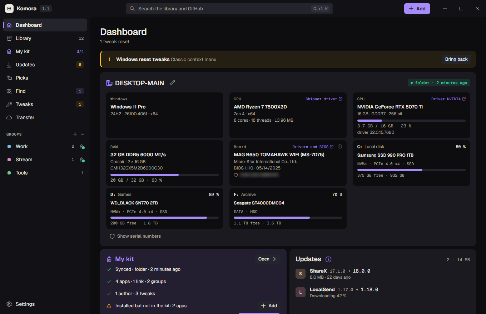
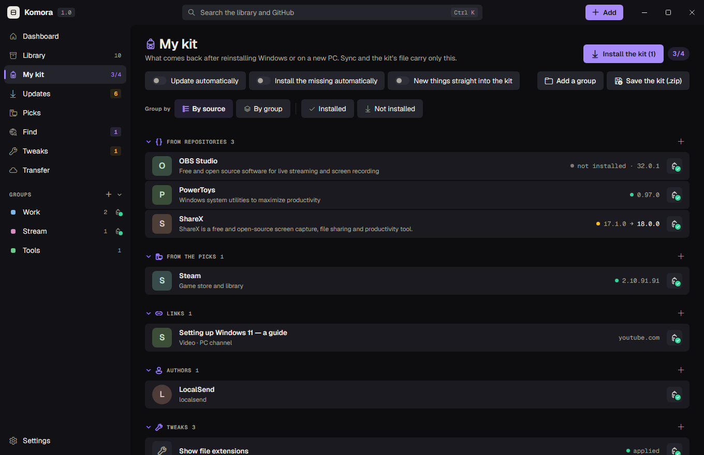
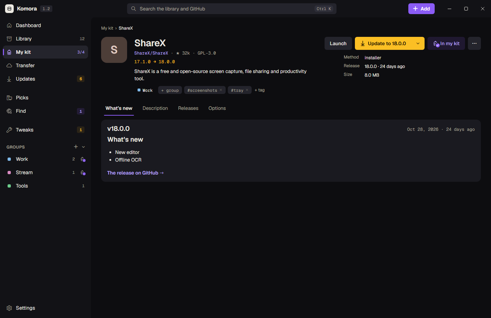
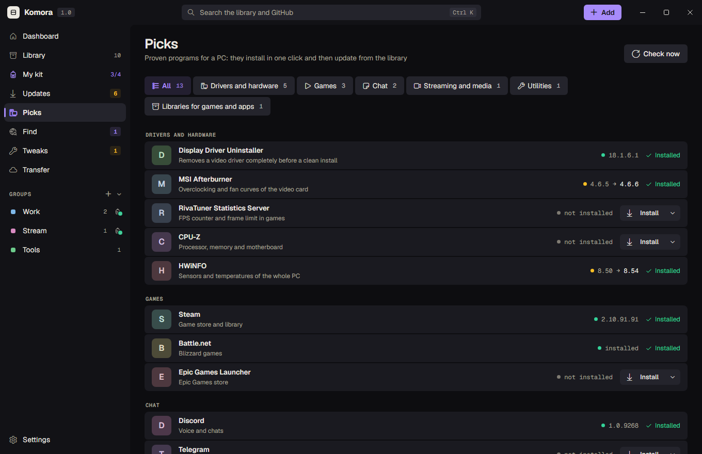
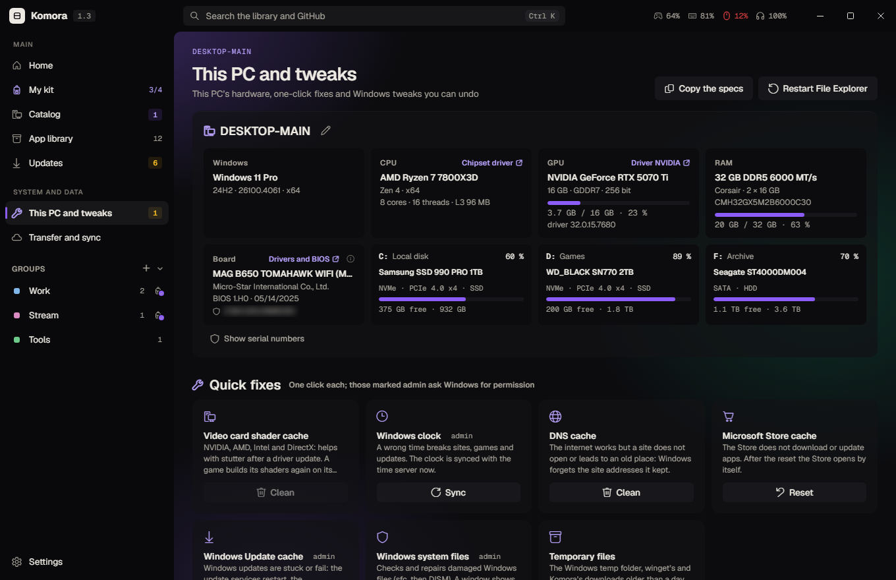

# Komora

[Українська](README.uk.md) · **English**

Your own storeroom of software for Windows 11. Keep the apps and links you use in one library — with groups, tags
and notes — and install and update the apps right from their releases on GitHub, GitLab or Codeberg or from a site's
own download page, or pick
everyday programs for a PC from **Picks** and install them through winget. Mark the apps that belong on every PC of
yours as **My kit**, and a new PC gets them in one click. Komora lives in the tray and checks for new versions by
itself.

<p align="center">
  
</p>
<p align="center">
  
  
</p>
<p align="center">
  
  
</p>

## Features

- **My kit.** What should come back after Windows is reinstalled or on a new PC: apps, links, groups, followed authors
  and tweaks, on a page of their own — by source or by group, installed or not, with a search and a quick add, «Install
  the kit» for the missing. «Home» tells whether Windows can be reinstalled now: is the kit synced elsewhere, are
  installed apps left out of it, which of its groups stand here.
  A violet mark puts an app into the kit from a library row, its page, GitHub results, or by dragging onto «My kit»; a
  group can add everything put into it by itself. The kit can update its apps and install itself on a new PC when it
  arrives with sync or a bundle; sync and the kit's own zip carry only the kit.
- **Picks.** About 70 proven free programs for a PC by category — driver and hardware tools, game launchers, chat,
  streaming and media, utilities, browsers, runtimes — installed, updated and removed through winget, with the
  download's progress, a cancel button and a folder of your choice; check several and install them at once. What is
  already on the PC goes into the library by itself, with its version, icon and what winget tells about it.
- **Programs already on this PC.** «Transfer» → «Programs on this PC» finds everything winget can install and brings
  what you check into the library and the kit in one go — a new PC then installs it all. Programs installed outside
  Komora are found by the Windows list and by Start menu and desktop shortcuts; their version is checked against the
  program's own files, so an app that updated itself or keeps a placeholder version is not offered a false update. A
  folder can be shown by hand when Komora cannot find it.
- **Download pages.** A link to a site's download page (SimHub, Crew Chief and the like) becomes an app: Komora reads
  the Windows files the page links to, installs the right one and offers a new file as an update. An archive holding
  only a setup runs that setup.
- **Device charge in the tray.** An icon with a charge bar for every device that reports its battery — Bluetooth
  headphones, mice, keyboards and gamepads, Logitech mice and keyboards on their receivers, ATK and VXE mice, Razer and
  SteelSeries mice, SteelSeries Arctis headsets, PlayStation and Xbox controllers — with its name and percent on hover
  and a note at 20 % and 10 %; a device that is switched off leaves the tray. A click opens Komora at the switches of the
  devices. The charge also shows in Komora's title bar and on «Home». It runs as a small process of its own and stays
  when Komora is closed; each icon closes from its right-click menu.
- **This PC.** «This PC and tweaks» shows Windows, the processor (microarchitecture, cores, threads, L3), video cards (memory
  type, bus, video memory in use), memory modules, the board with its BIOS and every disk (model, NVMe or SATA, PCIe
  link, SSD or HDD, space) — live while it is open — with links to the makers' driver and BIOS pages. Versions and
  codes are copied by a click; serial numbers show on demand.
- **A library of apps and links.** Paste a GitHub, GitLab or Codeberg repository or any link (Ctrl+V or drag it into the window) — Komora
  fetches the name, the app's own icon, the description and the README. The library is a table — source, version,
  update state, signature, the kit — with a filter; check several to update, group, share or remove them. Groups in the
  sidebar (drag apps onto them), tags, notes; dead links are marked.
- **Installs and updates from releases.** GitHub, GitLab and Codeberg: The right file for this PC (architecture, installer or portable),
  checksum and signature checks, silent setups (Inno Setup, NSIS, MSI, WiX), your own folder for setups and portable
  apps, pinned versions, skipped releases, a rollback for portable apps, older releases in one click. Komora updates
  itself the same way.
- **Checks on a timer.** Daily, weekly or monthly, with conditional requests (ETag), a Windows notification and a log
  of what was found. Pre-releases for one app or for all. «Updates» keeps a history of the versions installed, and a
  version can be skipped there — it stays one click away on the app's own page.
- **Safety.** Authenticode signature, SHA-256 against the release, VirusTotal: a lookup by hash, and with your free
  API key every install is checked and unknown files are uploaded.
- **One search.** The library, groups and tags and GitHub at once from the title bar; «Catalog» — Picks, GitHub search with
  filters, ready-made sets, star growth over the week and recent searches, and GitLab search. Forks of a project and
  which one is more alive.
- **Authors.** Follow a GitHub user or organisation and see their new repositories.
- **Windows tweaks and fixes.** A catalog of switches and your own (registry values or PowerShell), each can be undone;
  Komora notices when a Windows update resets them. Fixes in one click: the video card's shader cache, temporary files,
  the clock, the DNS cache, the Microsoft Store and Windows Update caches, Windows system files (sfc and DISM); white
  Steam shortcuts of games moved to another disk get their icons back.
- **Transfer.** One bundle file with the library, groups, tags, notes and tweaks; as a zip it also carries the apps'
  settings backups and Komora.exe itself. Share a set of apps as a link (a secret GitHub Gist) or as text, and keep
  the library the same on all your PCs through a secret Gist.
- **Settings backups.** Komora finds where an app keeps its settings, copies those folders and registry keys before
  every update and once a day when they change, and keeps the last five copies.
- **The look.** Its own title bar, a violet accent, glass cards with soft violet and green light behind them, and six
  backgrounds — obsidian, graphite and midnight dark, grey, white and sand light — the Geist typeface, light / dark / same as Windows. Nine languages: English, Ukrainian,
  German, French, Spanish, Portuguese, Polish, Italian and Turkish.

## Requirements

Windows 10 or 11 (x64 or ARM64) with the WebView2 runtime (built into Windows 11); Picks need winget (App Installer,
built into Windows 11). A GitHub token is optional: without
it GitHub allows 60 requests an hour, with one 5000; sync and sharing through a Gist need a token with the Gists
permission.

## Building

```
cargo build --release
```

Rust stable with the MSVC toolchain. The page of the window (`web/`) and its fonts are embedded into the exe.

## Status

1.3.2 — a new look: «Home», the library as a table, «Catalog», «This PC and tweaks» in one place. Tried for real: the library, GitHub search, update checks, portable installs, My kit, the bundle zip with
settings backups, the title bar, the hardware details, finding installed programs of Picks and installing
them through winget, the device charge in the tray (Bluetooth headphones and keyboards, a Logitech mouse on its
receiver and cable, an ATK mouse next to it). Not yet tried on real systems: setups of every kind, updates and
rollbacks, installs from GitLab, Codeberg and download pages, the winget import on another PC, PlayStation and Xbox
controllers, Razer and SteelSeries mice, sync and sharing through a Gist,
Komora's own update, the fixes, VirusTotal uploads. Reports are welcome in Issues.

## Support

<p align="center">
  <a href="https://send.monobank.ua/jar/6VR4c6nxzz"></a>
</p>

Komora is free. If it is useful to you, you can support it: [monobank jar](https://send.monobank.ua/jar/6VR4c6nxzz).

## License

GPL-3.0 — see [LICENSE](LICENSE). The Geist and Geist Mono typefaces — SIL Open Font License 1.1
([web/fonts/OFL.txt](web/fonts/OFL.txt)). Device icons — Material Symbols by Google (Apache-2.0) and Lucide (ISC); the
details and the licence texts are in [THIRD_PARTY.md](THIRD_PARTY.md).

Komora is an independent project. It is not affiliated with or endorsed by Microsoft, Valve, Sony, Logitech, Razer, SteelSeries, ATK, Nintendo, GitHub, GitLab or any other company named in it; their names and trademarks belong to their owners and are used only to say what Komora works with.
