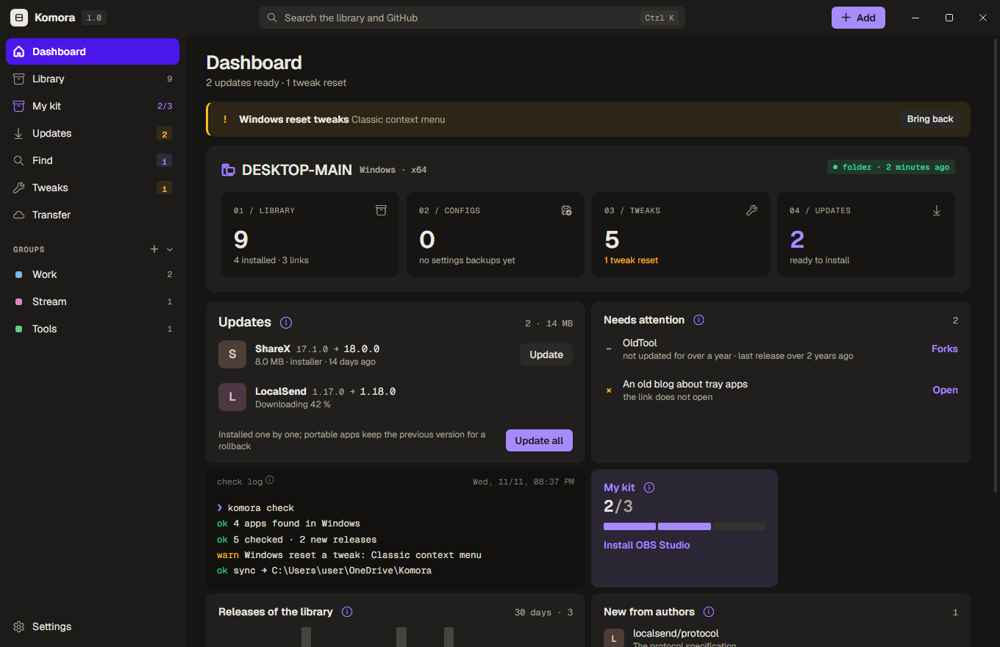
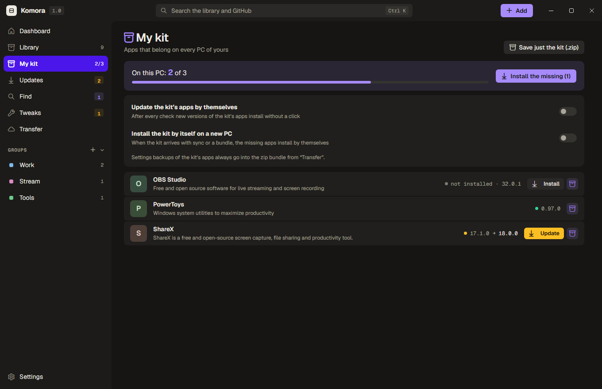
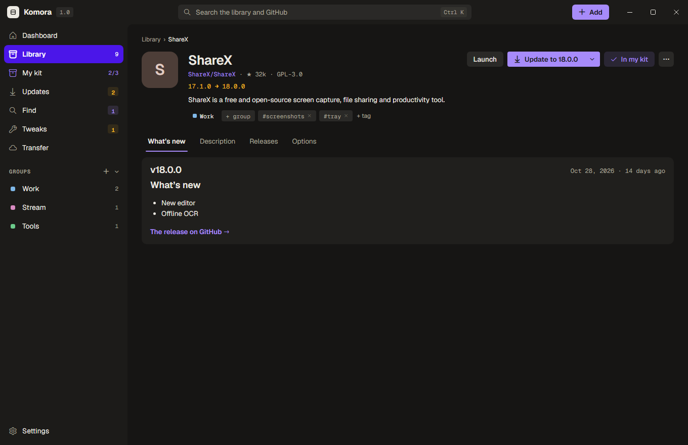
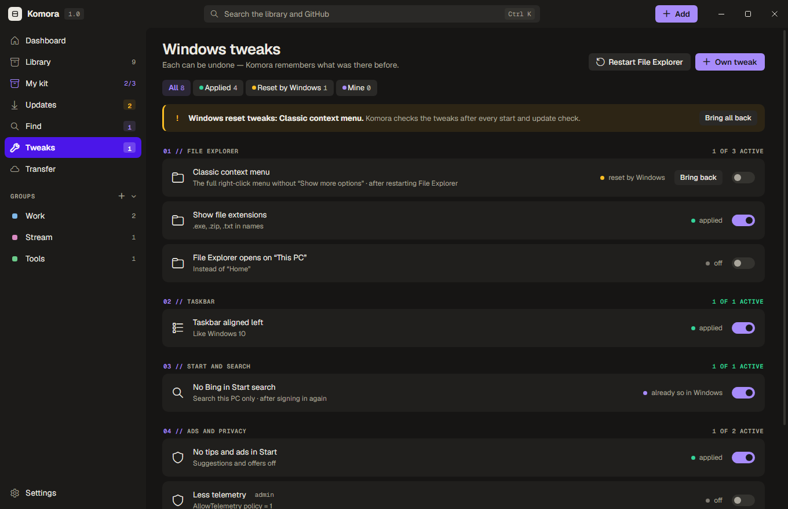

# Komora

[Українська](README.uk.md) · **English**

Your own storeroom of software for Windows 11. Keep the apps and links you use in one library — with groups, tags
and notes — and install and update the apps right from their GitHub releases. Mark the apps that belong on every PC
of yours as **My kit**, and a new PC gets them in one click. Komora lives in the tray and checks for new versions by
itself.

<p align="center">
  
</p>
<p align="center">
  
  
</p>
<p align="center">
  
</p>

## Features

- **My kit.** The apps that belong on every PC of yours, on a page of their own: how many are on this PC, «Install the
  missing», a violet mark on kit apps everywhere. Add to the kit from a library row, an app's page, GitHub results or
  a whole group, or drag apps onto «My kit». The kit can update its apps by itself and install itself on a new PC when
  it arrives with sync or a bundle; the kit's settings backups always travel in the zip, and the kit alone can be saved
  as a zip.
- **A library of apps and links.** Paste a GitHub repository or any link (Ctrl+V or drag it into the window) — Komora
  fetches the name, the app's own icon, the description and the README. Groups, tags, notes; dead links are marked.
- **Installs and updates from GitHub releases.** The right file for this PC (architecture, installer or portable),
  checksum and signature checks, silent setups (Inno Setup, NSIS, MSI, WiX), your own folder for setups and portable
  apps, pinned versions, skipped releases, a rollback for portable apps, older releases in one click. Komora updates
  itself the same way.
- **Checks on a timer.** Daily, weekly or monthly, with conditional requests (ETag), a Windows notification and a log
  of what was found. Pre-releases for one app or for all.
- **Safety.** Authenticode signature, SHA-256 against the release, VirusTotal: a lookup by hash, and with your free
  API key every install is checked and unknown files are uploaded.
- **One search.** The library, groups and tags and GitHub at once from the title bar; «Find» — GitHub search with
  filters, ready-made sets, star growth over the week and recent searches. Forks of a project and which one is more
  alive.
- **Authors.** Follow a GitHub user or organisation and see their new repositories.
- **Windows tweaks.** A catalog of switches and your own (registry values or PowerShell), each can be undone; Komora
  notices when a Windows update resets them.
- **Transfer.** One bundle file with the library, groups, tags, notes and tweaks; as a zip it also carries the apps'
  settings backups and Komora.exe itself. Share a set of apps as a link (a secret GitHub Gist) or as text, and keep
  the library the same on all your PCs through a secret Gist.
- **Settings backups.** Komora finds where an app keeps its settings, copies those folders and registry keys before
  every update and once a day when they change, and keeps the last five copies.
- **The look.** Its own title bar, warm greys with a violet accent (paper in the light theme), the Geist typeface,
  light / dark / like Windows, a background colour of your own. Nine languages: English, Ukrainian, German, French,
  Spanish, Portuguese, Polish, Italian and Turkish.

## Requirements

Windows 10 or 11 (x64 or ARM64) with the WebView2 runtime (built into Windows 11). A GitHub token is optional: without
it GitHub allows 60 requests an hour, with one 5000; sync and sharing through a Gist need a token with the Gists
permission.

## Building

```
cargo build --release
```

Rust stable with the MSVC toolchain. The page of the window (`web/`) and its fonts are embedded into the exe.

## Status

1.0.0. Tried for real: the library, GitHub search, update checks, portable installs, My kit, the bundle zip with
settings backups, the title bar. Not yet tried on real systems: setups of every kind, updates and rollbacks, sync and
sharing through a Gist, Komora's own update, the tweak catalog, VirusTotal uploads. Reports are welcome in Issues.

## Support

<p align="center">
  <a href="https://send.monobank.ua/jar/6VR4c6nxzz"></a>
</p>

Komora is free. If it is useful to you, you can support it: [monobank jar](https://send.monobank.ua/jar/6VR4c6nxzz).

## License

GPL-3.0 — see [LICENSE](LICENSE). The Geist and Geist Mono typefaces — SIL Open Font License 1.1
([web/fonts/OFL.txt](web/fonts/OFL.txt)).
