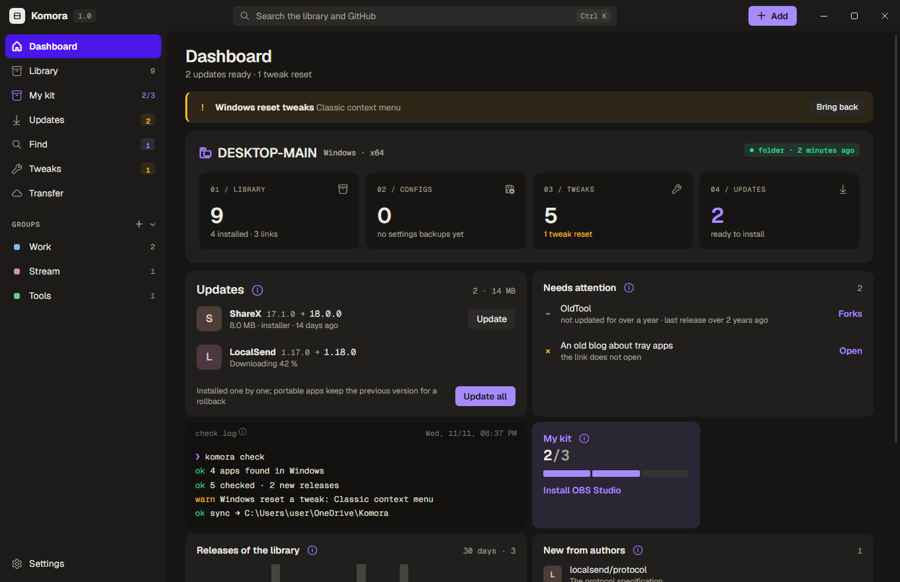
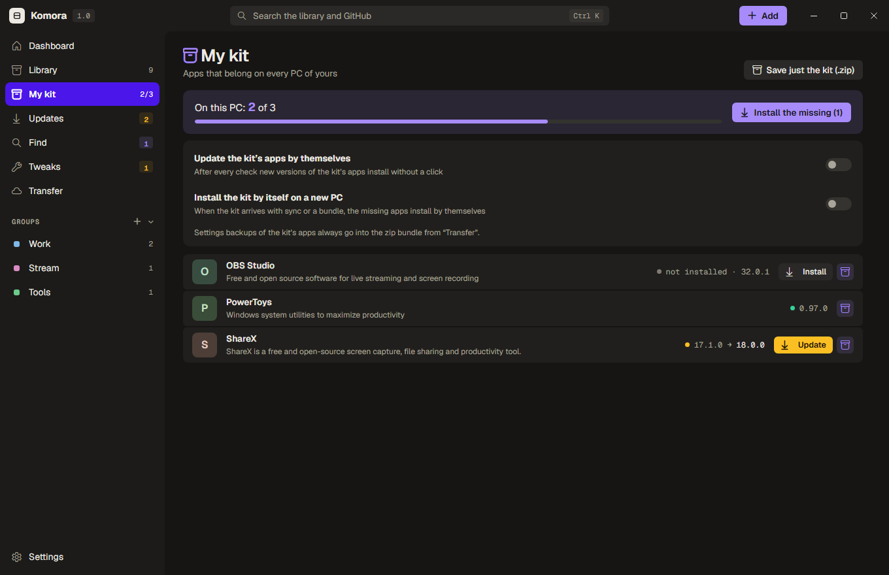
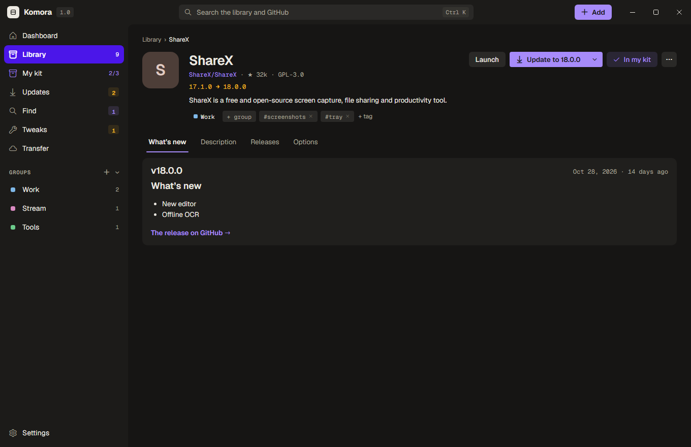
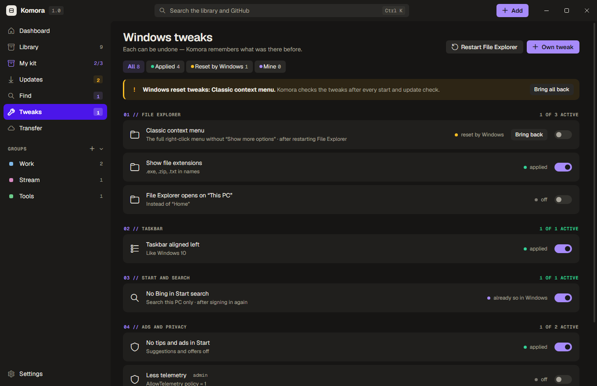

# Komora

**Українська** · [English](README.md)

Власна комора софту для Windows 11. Програми й посилання, якими користуєшся, — в одній бібліотеці з групами, тегами й
нотатками; програми встановлюються й оновлюються просто з релізів GitHub. Познач програми, що мають бути на кожному
твоєму ПК, як **Мій набір** — і новий ПК отримає їх одним кліком. Komora живе в треї й сама перевіряє нові версії.

<p align="center">
  
</p>
<p align="center">
  
  
</p>
<p align="center">
  
</p>

## Можливості

- **Мій набір.** Програми, що мають бути на кожному твоєму ПК, — на окремій сторінці: скільки їх стоїть на цьому ПК,
  «Встановити відсутні», фіолетова позначка програм набору скрізь. Додати в набір можна з рядка бібліотеки, сторінки
  програми, результатів GitHub чи цілою групою або перетягнути програми на «Мій набір». Набір може сам оновлювати свої
  програми й сам ставитися на новому ПК, коли приходить із синхронізацією чи файлом набору; копії налаштувань програм
  набору завжди їдуть у zip, а сам набір можна зберегти окремим zip.
- **Бібліотека програм і посилань.** Встав репозиторій GitHub чи будь-яке посилання (Ctrl+V або перетягни у вікно) —
  Komora підтягне назву, справжній значок програми, опис і README. Групи, теги, нотатки; мертві посилання
  позначаються.
- **Встановлення й оновлення з релізів GitHub.** Потрібний файл для цього ПК (архітектура, встановлювач чи портативна),
  перевірка контрольної суми й підпису, тихі встановлювачі (Inno Setup, NSIS, MSI, WiX), своя тека для встановлювачів і
  портативних, закріплена версія, пропущені релізи, відкат портативних, старіші релізи одним кліком. Komora так само
  оновлює й себе.
- **Перевірка за таймером.** Щодня, щотижня чи щомісяця, умовними запитами (ETag), зі сповіщенням Windows і журналом
  знайденого. Тестові релізи — для однієї програми або для всіх.
- **Безпека.** Підпис Authenticode, SHA-256 проти релізу, VirusTotal: пошук за хешем, а з твоїм безкоштовним ключем API
  кожне встановлення перевіряється само, невідомі файли вивантажуються.
- **Один пошук.** Бібліотека, групи й теги та GitHub разом — із шапки вікна; «Знайти» — пошук на GitHub із фільтрами,
  добірками, приростом зірок за тиждень і нещодавніми запитами. Форки проєкту й котрий із них живіший.
- **Автори.** Стеж за користувачем чи організацією GitHub і бач їхні нові репозиторії.
- **Твіки Windows.** Каталог перемикачів і свої (значення реєстру чи PowerShell), кожен можна скасувати; Komora помічає,
  коли оновлення Windows їх скидає.
- **Перенесення.** Один файл набору з бібліотекою, групами, тегами, нотатками й твіками; zip несе ще копії налаштувань
  програм і саму Komora.exe. Поділитися добіркою програм посиланням (секретний GitHub Gist) чи текстом, а бібліотеку
  тримати однаковою на всіх твоїх ПК через секретний Gist.
- **Копії налаштувань.** Komora сама знаходить, де програма тримає налаштування, копіює ці теки й гілки реєстру перед
  кожним оновленням і раз на день, якщо вони змінилися, і зберігає п'ять останніх копій.
- **Вигляд.** Власна шапка вікна, теплі сірі з фіолетовим акцентом (у світлій темі — папір), шрифт Geist, світла /
  темна / як у Windows, свій колір тла. Дев'ять мов: українська, англійська, німецька, французька, іспанська,
  португальська, польська, італійська й турецька.

## Вимоги

Windows 10 чи 11 (x64 або ARM64) із WebView2 (у Windows 11 вбудований). Токен GitHub — за бажанням: без нього GitHub
дає 60 запитів на годину, з ним 5000; синхронізації й поширенню через Gist потрібен токен із дозволом Gists.

## Збірка

```
cargo build --release
```

Rust stable з MSVC. Сторінка вікна (`web/`) і шрифти вшиваються в exe.

## Стан

1.0.0. Перевірено наживо: бібліотека, пошук на GitHub, перевірка оновлень, встановлення портативних, «Мій набір», zip
набору з копіями налаштувань, шапка вікна. Ще не перевірено на справжніх системах: встановлювачі всіх видів,
оновлення й відкати, синхронізація й поширення через Gist, оновлення самої Komora, каталог твіків, вивантаження на
VirusTotal. Звіти — в Issues.

## Підтримати

<p align="center">
  <a href="https://send.monobank.ua/jar/6VR4c6nxzz"></a>
</p>

Komora безкоштовна. Якщо вона тобі корисна, можеш підтримати: [банка monobank](https://send.monobank.ua/jar/6VR4c6nxzz).

## Ліцензія

GPL-3.0 — див. [LICENSE](LICENSE). Шрифти Geist і Geist Mono — SIL Open Font License 1.1
([web/fonts/OFL.txt](web/fonts/OFL.txt)).
